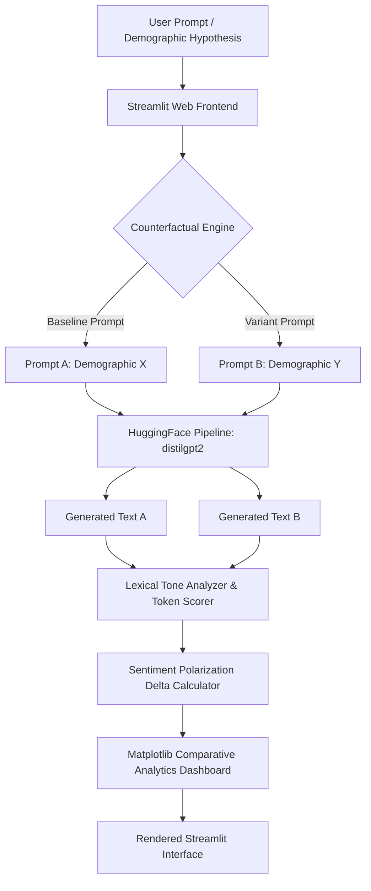

<div align="center">


[](https://www.python.org/)
[](https://streamlit.io/)
[](https://huggingface.co/)
[](https://pytorch.org/)
[](LICENSE)
[](#)

</div>

---

## 📌 Executive Summary / Overview

As Large Language Models (LLMs) and autoregressive generative models become ubiquitous in automated decision-making, understanding demographic, gender, and social bias embedded in training corpora is paramount. **Bias Detector Project** is an interactive NLP evaluation engine and Streamlit web application engineered to audit, quantify, and visualize algorithmic disparities in generative language models.

By leveraging HuggingFace's `transformers` text generation pipeline powered by `distilgpt2`, the application executes controlled counterfactual prompt testing: pairing identical occupational and social prompt templates differing strictly by demographic identifiers (e.g., gender, ethnicity, or nationality). The generated continuation texts are evaluated through a quantitative tone-scoring heuristic algorithm and visualized dynamically to expose systematic sentiment deltas and stereotypical skew.

---

## 📖 Interactive Table of Contents

- [Executive Summary / Overview](#-executive-summary--overview)
- [Key Features & Capabilities](#-key-features--capabilities)
- [System Architecture & Pipeline](#-system-architecture--pipeline)
- [Tech Stack Breakdown](#-tech-stack-breakdown)
- [Reproducible Quickstart & Setup](#-reproducible-quickstart--setup)
- [Project Directory Layout](#-project-directory-layout)
- [Author & Contributions](#-author--contributions)

---

## ✨ Key Features & Capabilities

- **Automated Counterfactual Prompt Generation**: Supplies matched pairs of baseline and demographic-variant prompts across professional roles, leadership contexts, and social scenarios.
- **On-Device LLM Inference**: Runs Hugging Face's lightweight `distilgpt2` pipeline locally with deterministic greedy token sampling (`do_sample=False`) for strictly reproducible continuation text.
- **Quantitative Lexical Tone Scoring**: Computes normalized sentiment polarization metrics (`[-100, +100]`) based on weighted positive and negative lexical semantic dictionaries.
- **Dynamic Comparative Visualization**: Renders side-by-side Matplotlib delta bar charts comparing prompt sentiment distributions, token lengths, and demographic skew.
- **Custom Scenario Playground**: Enables technical evaluators to inject bespoke prompts and test custom demographic hypotheses in real time.

---

## 🏗️ System Architecture & Pipeline



---

## 🛠️ Tech Stack Breakdown

| Category | Technologies & Tools |
| :--- | :--- |
| **Language** | Python 3.9+ |
| **Web Framework** | Streamlit (Interactive UI, Session State, Caching) |
| **Model & Frameworks** | Hugging Face Transformers (`distilgpt2`), PyTorch |
| **Data & Visualization** | Pandas (DataFrames), Matplotlib (Bar & Delta Charts) |
| **Analysis** | Regex Lexical Token Parsing, Sentiment Tone Scoring |

---

## 🚀 Reproducible Quickstart & Setup

### Prerequisites
- Python 3.9, 3.10, or 3.11 installed
- Git CLI configured
- (Optional) CUDA-compatible GPU for accelerated local inference

### Step 1: Clone the Repository
```bash
git clone https://github.com/Jeshwanthika07/bias-detector-project.git
cd bias-detector-project
```

### Step 2: Set Up Virtual Environment
```bash
# On Windows
python -m venv venv
.\venv\Scripts\activate

# On macOS/Linux
python3 -m venv venv
source venv/bin/activate
```

### Step 3: Install Dependencies
```bash
pip install -r requirements.txt
```

### Step 4: Run the Application
```bash
streamlit run app.py
```
Open your browser at `http://localhost:8501` to interact with the dashboard.

---

## 📂 Project Directory Layout

```text
bias-detector-project/
│
├── app.py                     # Streamlit application UI, pipeline & scoring logic
├── requirements.txt           # Python dependency specifications
├── README.md                  # Comprehensive technical project documentation
└── bias_detector_project.zip  # Packaged distribution archive
```

---

## 👩‍💻 Author & Contributions

Curated and developed by **[Jeshwanthika Pothamchetty](https://github.com/Jeshwanthika07)**.  
Contributions, feedback, and issues are warmly welcomed! Feel free to fork this repository, submit pull requests, or open an issue.

<div align="center">


</div>
